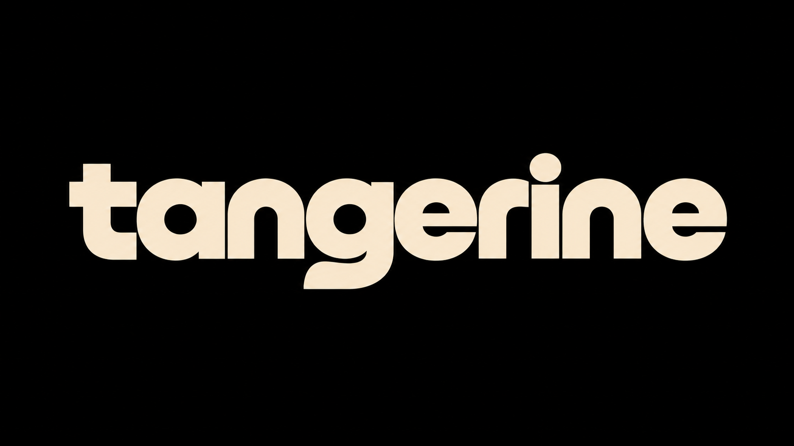

# Tangerine geometric wordmark

## Direction recorded 17 November 2026

Cole selected this image with “i love that” and requested that it be saved to GitHub. Preserve it as the preferred geometric wordmark direction for the Tangerine studio. This selection follows the earlier identity explorations documented in `/IDENTITY.md`.

Heavy lowercase lettering, rounded forms, compact single-storey g, and warm ivory on black. Preserve the proportions and character of this specific image when developing production artwork.

## Original asset

- Unmodified AI-generated PNG concept; not an editable font or finished vector master.
- Dimensions: 1672 × 941 pixels.
- SHA-256: `13a675192c5c90827cbd2e737d7606208a233885321709ce1866f73463db3b12`
- File: `tangerine-geometric-wordmark-original.png`

## Next production step

Redraw faithfully as editable vector outlines, refine optical spacing and counters, and test small-size legibility. Keep the original PNG intact and save refinements as separate versions. No font family or font license is claimed by this study.

This commit archives the selected artwork; it does not implement a website rebrand or deploy changes.
